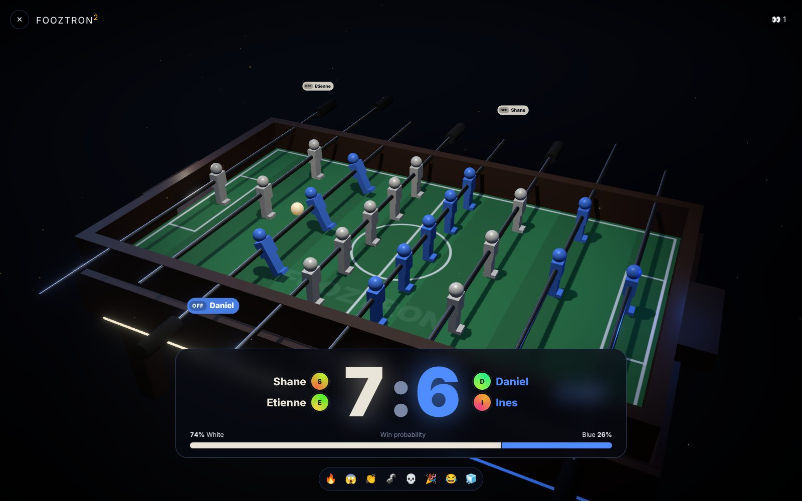
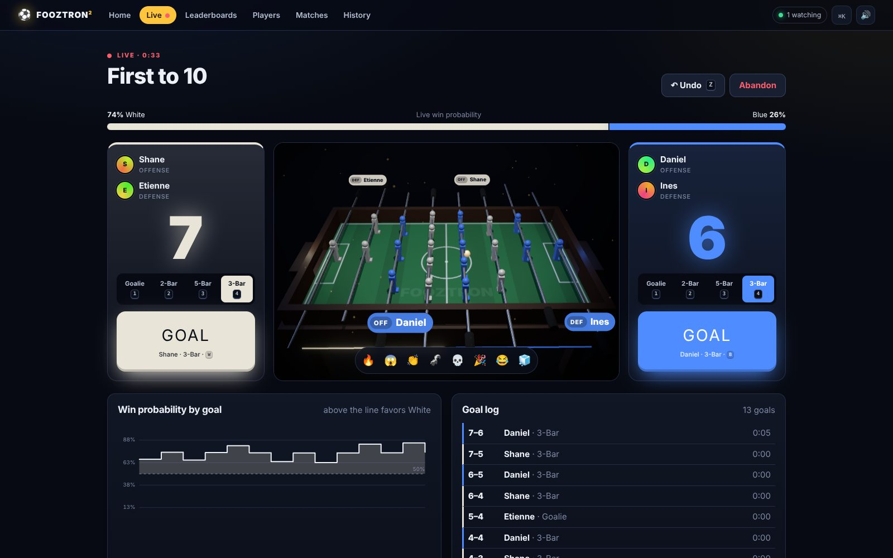
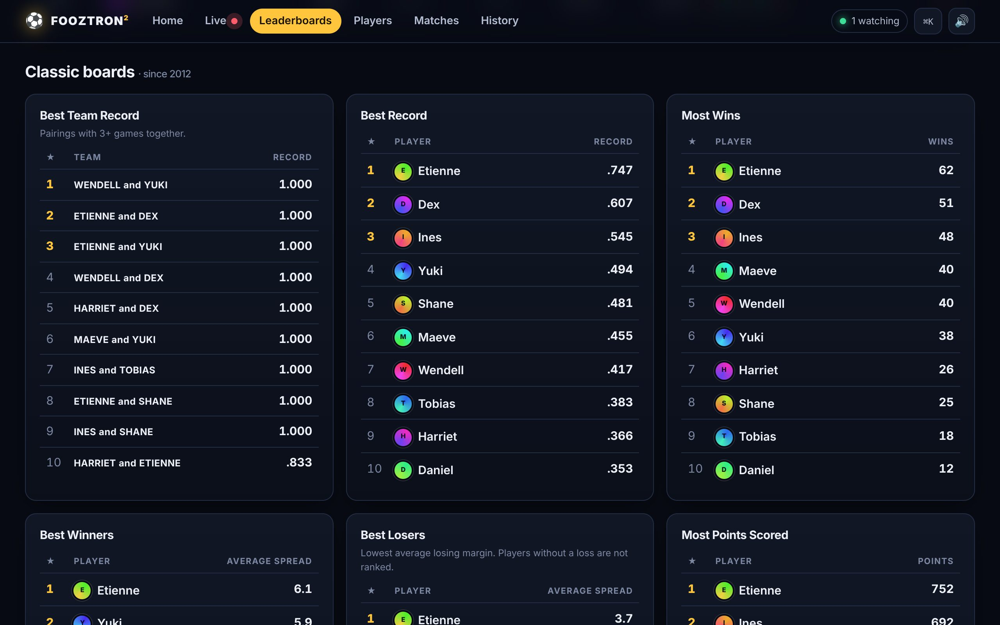
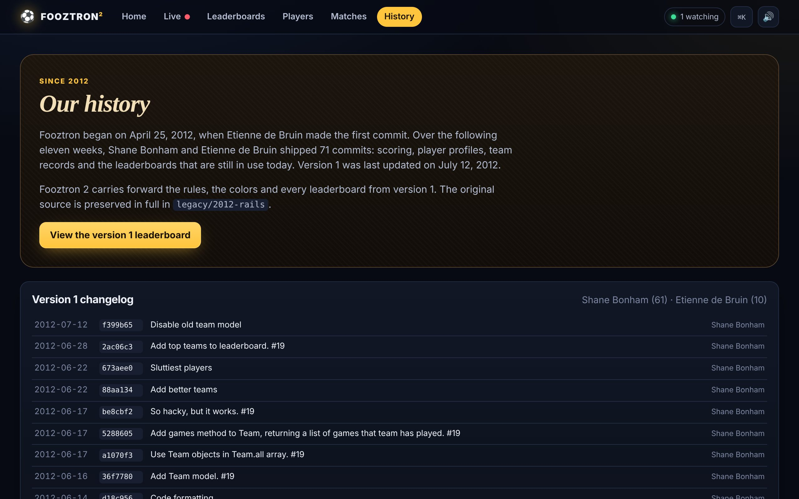
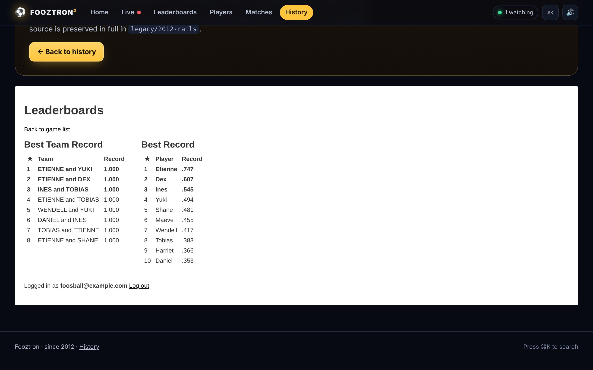
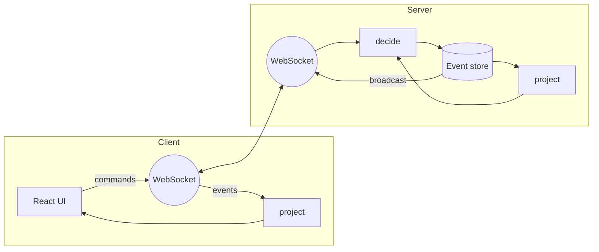

# Fooztron

Real-time scoring, ratings and match analytics for office foosball.



<table>
  <tr>
    <td></td>
    <td></td>
  </tr>
  <tr>
    <td></td>
    <td></td>
  </tr>
</table>

## Features

- **Live scoring.** Record goals from any device, including which rod scored. Keyboard shortcuts for the scorer.
- **Real-time sync.** Every connected screen updates within milliseconds over WebSockets, with spectator presence and reactions.
- **3D arena.** A rendered table that replays each goal as it is scored. Includes a fullscreen jumbotron view for displays.
- **FoozRank.** Positional Elo ratings (overall, offense and defense) with margin-of-victory weighting.
- **Live win probability.** Updated after every goal from pre-match ratings and the current score.
- **Lineup balancing.** Finds the fairest arrangement of any four players.
- **Leaderboards.** All version 1 boards (Best Team Record, Best Record, Most Wins, Best Winners, Best Losers, Most Points Scored, Most Points Allowed, Best Defender, Most Games Played, Most Promiscuous Offenders, Most Promiscuous Defenders) plus color-weighted record, positional ratings, streaks and personal goals.
- **Player profiles.** Rating history, position and color splits, head-to-head records, best partner and nemesis.
- **Achievements.** 18 achievements, unlocked automatically.
- **Match reports.** Goal-by-goal timeline, win-probability chart and 3D replay for every match.
- **Commentary.** Spoken play-by-play and synthesized stadium audio.

## Getting started

Requires Node.js 22.13 or later.

```bash
npm install
npm run dev
```

Open http://localhost:5173. An empty database is seeded with demo history on first run; set `FOOZTRON_SEED=none` to start empty.

### Production

```bash
npm run build
npm start
```

Or with Docker:

```bash
docker compose up
```

The server listens on port 4010 and stores data in SQLite at `FOOZTRON_DB` (default `data/fooztron.db`).

### Configuration

| Variable | Default | Description |
|---|---|---|
| `FOOZTRON_PORT` | `4010` | HTTP and WebSocket port |
| `FOOZTRON_DB` | `data/fooztron.db` | SQLite database path |
| `FOOZTRON_SEED` | `demo` | `demo` seeds an empty database; `none` disables seeding |
| `FOOZTRON_ROSTER` | | Comma-separated player names for demo data |

### Scorer shortcuts

| Key | Action |
|---|---|
| <kbd>W</kbd> / <kbd>B</kbd> | Goal for white / blue |
| <kbd>1</kbd>–<kbd>4</kbd> | Select rod (goalie, 2-bar, 5-bar, 3-bar) |
| <kbd>Z</kbd> | Undo last goal |
| <kbd>⌘K</kbd> | Search |

## Architecture



Fooztron is event-sourced. Commands are validated by `decide()`, appended to the event store, and broadcast to all clients. The server and every client derive state with the same `project()` function. See [docs/ARCHITECTURE.md](docs/ARCHITECTURE.md) and the [architecture decision records](docs/adr/).

```
src/shared   domain model, rules, ratings, statistics
src/server   HTTP/WebSocket server, event store, seeding
src/client   web client and 3D arena
tests        unit tests
legacy       Fooztron 1 source (2012)
```

## Operations

| Endpoint | |
|---|---|
| `GET /api/health` | Health check |
| `GET /metrics` | Prometheus metrics |
| `GET /api/events` | Event log |
| `POST /api/commands` | Command endpoint |

## Development

```bash
npm test           # unit tests
npm run typecheck  # TypeScript
npm run seed       # regenerate demo data
```

## History

Fooztron was created in 2012 by Etienne de Bruin and Shane Bonham. The version 1 source is preserved in [`legacy/2012-rails`](legacy/2012-rails).
